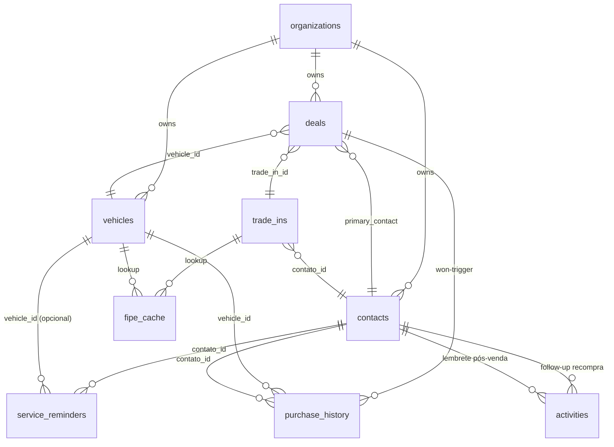
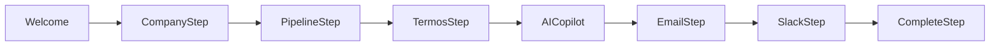

# 10 — Vertical Automotiva (CRM Automotivo)

Documento da vertical **CRM Automotivo** — 5º remix do FlowCRM, no padrão Causa. Cobre o que muda em relação aos docs 01–09 (que continuam valendo como fundação). Leia depois do [04 — Módulos](./04-modules.md), do [02 — Schema](./02-database-schema.md) e do [07 — Edge Functions](./07-edge-functions.md).

## 1. Visão geral

**CRM Automotivo** é o CRM para concessionárias multimarca PME (5–30 vendedores), com foco em PF/consumidor final, venda de seminovos/usados e novos sem amarra de montadora. O ciclo coberto é **lead → test drive → fechamento → entrega → pós-venda → recompra**.

- **ICP**: concessionária multimarca PME (5–30 vendedores), venda PF, com ou sem oficina própria. Hoje opera em planilha + WhatsApp solto + papel.
- **Posicionamento**: *"O CRM que fecha o ciclo do automotivo PME: do lead ao test drive, do fechamento à próxima troca, sem planilha."*
- **Gap competitivo**: Linx DMS e Syonet começam dentro do DMS de montadora e são caros pro PME; Autoforce e BizCar só captação OU só ordem de serviço — ninguém costura `estoque ⇄ pipeline ⇄ recompra ⇄ pós-venda`. É aí que o CRM Automotivo entra.
- **Não é Nina Automotiva.** Nina é o SDR WhatsApp de qualificação; o CRM é o downstream que pega o lead qualificado e leva até o pós-venda. Integração via webhook (Fase 6).

## 2. Stack

Herdada do FlowCRM, **sem mudanças**: React + Vite + Tailwind + shadcn/ui, Supabase (Lovable Cloud), Edge Functions, Lovable AI Gateway, pg_cron. Ver [01 — Arquitetura](./01-architecture.md).

## 3. Killer features

As 4 combinadas é o que diferencia. Nenhuma sozinha sustenta o produto.

### 3.1 Estoque integrado ao pipeline
- Tabela `vehicles` com status (`disponivel|reservado|vendido|em_preparacao`), galeria de fotos, FIPE cacheada.
- Bloco "Veículo de interesse" no `DealDetail` faz lookup direto em `vehicles` por marca/modelo/ano/faixa de preço.
- Quando o deal vai pra stage **Proposta**, o veículo automaticamente vai pra `reservado`. Quando fecha-ganho, vai pra `vendido` e dispara INSERT em `purchase_history` (via trigger `won-trigger`).
- `/estoque/:id` mostra "histórico de interesse" — quantos deals olharam, quem fechou, quem perdeu.

### 3.2 Avaliação de troca com IA (trade-in)
- Cliente sobe 4–8 fotos do carro dele + dados (marca/modelo/ano/km/condição) em `/avaliacoes/nova`.
- Edge Function `evaluate-trade-in` chama o Lovable AI Gateway pra analisar estado visual, cruza com FIPE (cache `fipe_cache`, TTL 7 dias), devolve `estimativa_ia numeric` + `estimativa_ia_justificativa text`.
- Vendedor revisa, ajusta `valor_final_ofertado`, vincula ao `deal_id`.
- Exemplo: foto com lataria amassada + km alto → IA puxa FIPE R$ 52.000 e devolve estimativa R$ 44.500 com justificativa "lataria com avarias visíveis no para-lama direito; km acima da média de mercado para o ano".

### 3.3 Recompra automática (ciclo 3–5 anos)
- `contacts.purchase_cycle_months` default 36 (configurável por cliente).
- `dispatch_repurchase_alerts` (pg_cron diário 06:00 UTC) varre `purchase_history` por contatos na janela `purchase_cycle_months ± 90 dias` e cria activity "follow-up recompra" + sugere veículo do estoque compatível (mesma marca preferida, segmento equivalente, faixa de preço).
- Rota `/recompra` mostra a lista filtrável (marca, segmento, vendedor) com botão "criar deal" 1-click.

### 3.4 Pós-venda recorrente
- Tabela `service_reminders` com tipos `revisao_km | revisao_tempo | ipva | seguro | licenciamento`.
- `dispatch_service_reminders` (pg_cron diário 06:15 UTC) varre vencimentos próximos e cria activities. Sugere WhatsApp se feature flag `whatsapp_enabled=true` (default `false` no MVP).
- Pipeline **Pós-venda** (criado no onboarding se `tem_oficina=true`): Agendado → Em serviço → Aguardando peça → Concluído.

## 4. Schema novo

Estratégia: **estender, não recriar**. Migrations aplicadas via MCP `lovable_query_sql` (banco Lovable Cloud não aceita supabase CLI local — memória `feedback_lovable_cloud_migrations`).

### Tabelas novas

| Tabela | Propósito |
|---|---|
| `vehicles` | Estoque. Inclui marca, modelo, versão, ano_fab/modelo, km, cor, placa, chassi, renavam, combustivel, transmissao, preco_venda, preco_custo, status, fotos[], deal_id_atual, fipe_code, fipe_price. UNIQUE parciais em `(org_id, placa)` e `(org_id, chassi)`. |
| `trade_ins` | Avaliação de troca. deal_id, contato_id, dados do veículo, fotos[], estimativa_fipe, estimativa_ia, estimativa_ia_justificativa, valor_final_ofertado, status (`aguardando|avaliado|aceito|rejeitado`). |
| `service_reminders` | contato_id, vehicle_id (opcional), tipo, data_vencimento, status, ultimo_alerta_em. |
| `purchase_history` | Snapshot imutável de deal fechado. vehicle_id, contato_id, data_compra, valor, payment_method, financiamento_banco. Insert via trigger `won-trigger`. |
| `fipe_cache` | Cache da API pública FIPE. `(marca, modelo, ano, fipe_code, valor, fetched_at)` com TTL 7 dias. |

### Colunas adicionadas

| Tabela | Colunas novas |
|---|---|
| `deals` | `vehicle_id` (FK vehicles), `trade_in_id` (FK trade_ins), `payment_method` (`avista|financiado|consorcio|leasing`), `financing_status`, `delivery_date timestamptz`, `test_drive_at timestamptz` |
| `contacts` | `cpf` (normalizado, UNIQUE parcial por org), `cnh_categoria`, `preferred_brand`, `purchase_cycle_months int default 36` |
| `tags` | `kind` recebe `vehicle_brand` e `vehicle_segment` (hatch / sedan / SUV / picape / utilitário) |

### Storage

- `vehicle-photos` — bucket público com signed URL (galeria do estoque).
- `trade-in-photos` — bucket privado, policy via `user_belongs_to_org`.

### Diagrama (alto nível)



## 5. Pipelines seed

Criados no onboarding via `PipelineStep` (Fase 3). Apenas um marcado `is_default`.

- **Venda PF** (sempre criado): Lead → Qualificado → Test Drive → Proposta → Financiamento/Pagamento → Fechado-Ganho / Fechado-Perdido.
- **Pós-venda** (criado se `tem_oficina=true` no `CompanyStep`): Agendado → Em serviço → Aguardando peça → Concluído.

Stage "Proposta" move `vehicles.status` → `reservado`. Stage "Fechado-Ganho" dispara `won-trigger` → INSERT em `purchase_history` + `vehicles.status='vendido'`.

## 6. Edge Functions automotivas

Reaproveita 100% da infra `ai-copilot / ai-insights / ai-sales-manager / ai-email`. Funções novas:

### 6.1 `evaluate-trade-in` (Fase 5)
- Input: `{ trade_in_id, fotos: string[], marca, modelo, ano, km, condicao }`.
- Fluxo: baixa fotos do bucket privado → chama Lovable AI Gateway (vision) → cruza com FIPE (via `fipe_cache` ou fetch fresh) → grava `estimativa_ia`, `estimativa_ia_justificativa`, `estimativa_fipe` no `trade_ins`.
- Audit: log em `audit_logs` com `entity_type='ai_trade_in_call'` + `metadata.model`.

### 6.2 `fipe-refresh` (Fase 6)
- Cron interno + endpoint manual. Atualiza `fipe_cache` consumindo `https://parallelum.com.br/fipe/api/v1`.
- TTL 7 dias. Se a API cai, fallback é o último valor cacheado + flag `stale=true`.

### 6.3 `nina-webhook` (Fase 6)
- Endpoint público (`verify_jwt=false`) que recebe leads qualificados da Nina Automotiva.
- Cria contato (deduplica por CPF ou telefone) e deal no pipeline **Venda PF** na stage **Qualificado**.
- Autenticação HMAC obrigatória — ver runbook abaixo.

## 7. Dispatchers diários (pg_cron)

```sql
cron.schedule('dispatch_repurchase_alerts_daily', '0 6 * * *',
  $$ SELECT public.dispatch_repurchase_alerts(); $$);
cron.schedule('dispatch_service_reminders_daily', '15 6 * * *',
  $$ SELECT public.dispatch_service_reminders(); $$);
```

- **06:00 UTC** — `dispatch_repurchase_alerts`: varre `purchase_history` LEFT JOIN `contacts` onde `data_compra + purchase_cycle_months` está na janela ±90 dias do hoje. Cria activity `tipo='follow_up_recompra'` se ainda não existe ativa para o mesmo contato.
- **06:15 UTC** — `dispatch_service_reminders`: varre `service_reminders` onde `data_vencimento` está em D-30 / D-15 / D-7 / D-1 / D0 e `ultimo_alerta_em IS NULL OR < hoje`. Cria activity + atualiza `ultimo_alerta_em`.

GUCs do dispatch via Supabase Vault (mesmo workaround do Causa). Coluna `ultimo_alerta_em` evita duplo-disparo.

## 8. Runbook — `nina-webhook`

### Autenticação HMAC

A Nina Automotiva (cliente) DEVE enviar 2 headers em cada POST:

| Header | Valor |
|---|---|
| `X-Nina-Timestamp` | Unix seconds em string. Janela aceita: ±300s. |
| `X-Nina-Signature` | `sha256=` + HMAC-SHA256(`{timestamp}.{rawBody}`, secret) em hex lowercase. O prefixo `sha256=` é opcional, ambas formas são aceitas. |

Padrão Stripe/GitHub/Slack: o timestamp entra dentro do conteúdo assinado pra prevenir replay (CWE-294). Sem qualquer um dos headers → **401**. Timestamp fora da janela → **401**. Assinatura inválida → **401**.

Secret resolvido em 2 níveis:
1. `vault_get('nina_webhook_secret')` (preferencial, produção).
2. Fallback env `NINA_WEBHOOK_SECRET` (dev local).

### Exemplo de cliente (Node.js)

```js
const crypto = require('crypto');

const secret = process.env.NINA_WEBHOOK_SECRET;
const body = JSON.stringify({
  org_id: '550e8400-e29b-41d4-a716-446655440000',
  contato: {
    nome: 'João da Silva',
    telefone: '+5511999999999',
    cpf: '12345678900',
    preferred_brand: 'Toyota',
  },
  lead_summary: 'Quer trocar o Corolla 2018 por um Hilux 2023 ou seminovo equivalente.',
  qualification_score: 82,
  vehicle_interest: { marca: 'Toyota', modelo: 'Hilux', ano_target: 2023 },
});

const ts = Math.floor(Date.now() / 1000).toString();
const sig = crypto.createHmac('sha256', secret).update(`${ts}.${body}`).digest('hex');

await fetch('https://<project>.functions.supabase.co/nina-webhook', {
  method: 'POST',
  headers: {
    'Content-Type': 'application/json',
    'X-Nina-Timestamp': ts,
    'X-Nina-Signature': `sha256=${sig}`,
  },
  body,
});
```

### Respostas

| Status | Significado |
|---|---|
| `200 { ok: true, deal_id, contact_id }` | Lead aceito; deal criado em "Qualificado". |
| `200 { ok: true, deal_id, contact_id, deduped: true }` | Contato já existia (match por CPF ou telefone); deal vinculado ao existente. |
| `401 { error: "missing signature" }` | Header `X-Nina-Signature` ou `X-Nina-Timestamp` ausente. |
| `401 { error: "timestamp drift" }` | Timestamp fora da janela ±300s. |
| `401 { error: "invalid signature" }` | HMAC não bate. |
| `400 { error: "invalid payload" }` | `org_id` ou `contato.nome` ausente. |
| `404 { error: "org not found" }` | `org_id` não existe ou pipeline "Venda PF" não configurado. |

### Troubleshooting

1. **401 invalid signature repetido** → confira se o body assinado é exatamente o `rawBody` enviado (sem re-serializar JSON). Diferença de espaço quebra a assinatura.
2. **401 timestamp drift** → relógio do cliente desalinhado. NTP sync.
3. **404 org not found** → rodar onboarding completo nessa org pra criar o pipeline "Venda PF" seed antes de apontar a Nina.
4. **Secret rotacionado** → atualizar no Vault e em paralelo na config da Nina; aceitar drift de 5 min entre rotação e propagação.

## 9. Onboarding automotivo (Fase 3)

Substitui o onboarding genérico do FlowCRM. 3 steps obrigatórios + steps opcionais herdados (AI, Email, Slack).



### `CompanyStep`
- Nome da concessionária + **CNPJ** (validado) + **marcas trabalhadas** (multi-select com seed das 15 maiores no BR) + **volume médio mensal de vendas** (faixa) + **tem oficina própria?** (boolean — condiciona criação do pipeline Pós-venda).

### `PipelineStep`
- Cria pipeline **Venda PF** com 6 stages (sempre, marcado `is_default=true`).
- Se `tem_oficina=true` no step anterior, cria também **Pós-venda** com 4 stages.
- Idempotente: rerun não duplica.

### `TermosStep`
- Termo obrigatório de uso de IA com dados de cliente (LGPD). Grava em `settings.lgpd_ai_consent` com `accepted_at` e `accepted_by`.
- Sem aceite → onboarding bloqueado.

## 10. Roadmap pós-MVP

| Versão | Entrega |
|---|---|
| **v1.1** | **Nina Auto** — integração bidirecional com Nina Automotiva. CRM empurra "lead esfriou" / "test drive marcado" de volta pro WhatsApp; Nina puxa status de deal. |
| **v1.2** | **Documentos digitais** — proposta PDF assinável, OCR de CRLV no trade-in pra autopreencher chassi/renavam, contrato de compra/venda gerado. |
| **v1.3** | **Cotação de financiamento** — integração BV / Santander Financiamento / Bradesco Financiamento. Resposta em minutos dentro do deal. |
| **v1.4** | **Portal do cliente** — acompanhamento da entrega, garantia, agendamento de revisão e download de documentos. |
| **v1.5** | **Multi-loja / grupo de concessionárias** — filial, transferência de estoque entre lojas, dashboard consolidado. |
| **v2.0** | **DMS de montadora** — integração Linx / Syonet, só se o ICP migrar pra autorizada (hoje fora do escopo PME). |

## 11. Off-limits do MVP

Cortado explicitamente. Pedidos para qualquer item abaixo viram backlog.

- **WhatsApp SDR pesado / Evolution API** — fica na Nina Automotiva.
- **Integração DMS de montadora** (VW Dealer Net, Fiat DMS) — buraco sem fundo, foge do ICP PME.
- **Cotação direta de financiamento** com bancos — só registro de status no MVP, integração na v1.3.
- **Emissão de CRLV / NF-e de veículo** — fora.
- **Despachante / Detran** — fora.
- **App mobile nativo** — PWA / web responsivo basta.
- **BI elaborado** — usuário pluga Power BI; dashboard interno fica em KPIs essenciais.
- **FIPE como SLA crítico** — API pública gratuita com cache; se cair, manual.

## 12. Pendências operacionais

Itens que **NÃO** são código — dependem de ação do admin antes do produto ir pra produção real.

- **`app_service_role_key` no Vault** — entrou como placeholder na Fase 0. O admin Supabase precisa rotacionar pra **service_role real** (não a anon) via Dashboard. Sem isso, os dispatchers diários (`dispatch_repurchase_alerts` e `dispatch_service_reminders`) falham silenciosamente ao chamar edge functions com permissão elevada. Herança do workaround do Causa.
- **`nina_webhook_secret` no Vault** — entrou como placeholder na Fase 6. Admin precisa gerar um secret forte (32+ bytes random hex), gravar no Vault E configurar o **mesmo valor** no cliente Nina Automotiva. Sem isso, todas as chamadas retornam 401.
- **GUC Vault herdado** — confirmar que `vault_get` está retornando os valores corretos após rotação (`SELECT vault_get('nina_webhook_secret')` no SQL editor).
- **Buckets de Storage** — `vehicle-photos` (público) e `trade-in-photos` (privado) precisam ser criados no Dashboard Supabase. Migration cria a policy, mas o bucket em si é via UI/MCP.
- **Cron timezone** — `pg_cron` roda em UTC. `0 6 * * *` = 03:00 BRT (verão) / 03:00 BRT (sem DST no BR desde 2019). Confirmar com o cliente se 03:00 da manhã pra disparar alertas tá ok ou se deve ser 09:00 UTC (06:00 BRT).

## 13. Comandos úteis

```bash
# desenvolvimento
npm install
npm run dev

# migrations: aplicar via MCP lovable_query_sql (NÃO via supabase CLI local)
# o Lovable Cloud Supabase só aceita via MCP — memória feedback_lovable_cloud_migrations

# forçar dispatcher manual (debug)
# psql via MCP:
SELECT public.dispatch_repurchase_alerts();
SELECT public.dispatch_service_reminders();

# inspecionar cron jobs
SELECT jobname, schedule, command FROM cron.job;
SELECT * FROM cron.job_run_details ORDER BY start_time DESC LIMIT 10;
```

Para deploy: push na main → Lovable rebuilda; avisar Deivid pra dar pull/update no editor (memória `feedback_lovable_deploy`).
